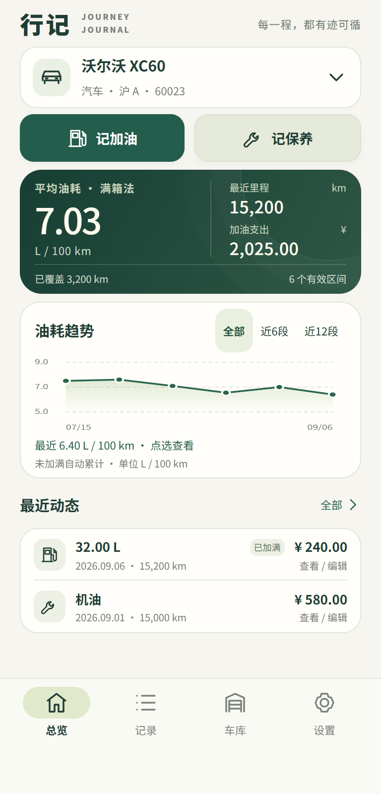

# 行记 · Journey Journal

离线管理多辆汽车和摩托车的加油、油耗及保养记录。Android 13+，无需账号、联网权限或 Google Play 服务。

## 下载 v1.1.0

- [正式发布与 APK 下载](https://github.com/FlypigLee/xingji/releases/tag/v1.1.0)
- [完整源码包](Xingji-source-1.1.0.zip)：解压后包含 app/、tests/、docs/、build.ps1 与详细构建说明，保留原始目录结构。



截图使用演示数据和模拟导航安全区，首次安装不含示例记录。

## 功能

- 汽车、摩托车分车管理，记录和保养快捷项独立。
- 支持加满与未加满，用满箱法计算油耗，并显示历史趋势。
- 加油和保养记录支持查看、修改、删除；统计即时重算。
- 支持本地 JSON 备份导出与恢复。

## 1.1.0 更新

快捷加油/保养按钮移至首页上方；摘要卡、趋势图和最近动态采用紧凑布局；设置入口仅保留底部一处；适配手势和三键导航的底部安全区，并处理键盘遮挡。

使用与旧版本相同的发布签名，可覆盖安装并保留数据。卸载前请先导出备份。

## 技术与验证

原生 Java Activity + APK 内置本地 WebView UI。使用 Android 17 SDK 37.2 编译，targetSdk 37，minSdk 33。源码包附有 PowerShell 构建脚本与测试，签名私钥和密码不随源码公开。

已通过 9 项算法测试、界面功能回归、多尺寸/导航安全区模拟、APK 签名和对齐校验。1.0.1 的启动修复已获用户实机确认；1.1.0 导航效果尚未完成三星真机验证。大字体、长内容和横屏保留滚动。

APK SHA-256：

```text
A61F2733B240DFFDF734C01C7F2914330E5CDA37138C816468CA16A676B0D66A
```
